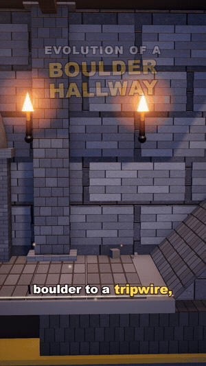

# SimForge

> Modular Remotion + React Three Fiber framework for creating episodic, 3D animated procedural simulations and short-form vertical videos (9:16, 1080x1920 @ 30fps).

---

## 🎬 Output Demo (10s Showcase)

<div align="center">
  
  <p><em>Procedural 3D simulation, dynamic waypoint camera tracking, particle FX, and synchronized word-level captions rendered entirely with SimForge.</em></p>
  <p><a href="media/demo.mp4">▶ <strong>Watch 10s Clip with Audio & SFX (demo.mp4)</strong></a></p>
</div>

---

## Overview

`SimForge` provides a structured workflow for generating high-fidelity 3D vertical simulation and explainer videos. It combines **Remotion** (React-based video rendering engine) with **Three.js** and **React Three Fiber** (`@react-three/fiber`), enabling code-driven 3D animation, dynamic camera direction, procedural environments, audio integration, and synchronized word-level captions.

### Highlights

- **Episodic Structure**: Isolated episodes defined with unified configuration (`id`, dimensions, fps, duration, camera, environment, audio, subtitles, overlays).
- **Camera Director (`CameraRig`)**: Multi-waypoint smooth camera interpolation with configurable shake bursts and rumble effects.
- **Procedural Environments (`EnvironmentScene`)**: Custom shader sky domes, canvas-generated procedural ground textures (cracks, patches), directional lighting with shadow maps, layered low-poly clouds, and background terrain hills.
- **Word-Level Synced Captions (`Subtitles`)**: Dynamic pop animations, active word highlighting, progress bars, and high-readability drop shadows optimized for mobile vertical feeds.
- **Procedural 3D Artifacts**: Built-in library of procedural 3D elements (characters, siege weapons, fortress walls, props) without external 3D file dependencies.
- **Scaffolding CLI**: Instantly bootstrap a new episode with `npm run new:episode -- <slug> [Title]`.

---

## Architecture

```
simforge/
├── scripts/
│   └── new-episode.mjs             # Scaffolding CLI for new episodes
├── templates/
│   └── episode/                    # Boilerplate template for new episodes
├── public/
│   └── episodes/                   # Public assets (audio, voiceovers)
├── src/
│   ├── Root.tsx                    # Remotion root registering all compositions
│   ├── index.ts                    # Entry point calling registerRoot
│   ├── artifacts/                  # Procedural 3D asset library
│   │   ├── characters/             # SoldierUnit, ArrowVolley
│   │   ├── dungeon/                # Diorama, SpikePit, Trapdoors, Flamers, Pendulum, Catapult, Mimic
│   │   ├── machines/               # SiegeTower, ScalingLadder
│   │   ├── props/                  # Banner, Crate, Rock, Tree
│   │   └── structures/             # FortressWall
│   ├── engine/                     # Core runtime & reusable components
│   │   ├── AudioTrack.tsx          # Dynamic audio with fade-in / fade-out
│   │   ├── CameraRig.tsx           # Waypoint-interpolated camera & shake
│   │   ├── EnvironmentScene.tsx    # Sky shader, ground textures, lights, clouds
│   │   ├── EpisodeVideo.tsx        # Top-level composition renderer
│   │   ├── Overlays.tsx            # Color grade, vignette, and fade transitions
│   │   ├── Subtitles.tsx           # Karaoke-style synced caption renderer
│   │   ├── defineEpisode.tsx       # Episode definition factory
│   │   ├── presets.ts              # Environment presets (ancientBattlefield, sunset, night)
│   │   ├── types.ts                # TypeScript schemas for all configs
│   │   └── primitives/             # Motion primitives (FlyInPart, HingePart)
│   └── episodes/                   # Episodic compositions
│       ├── registry.ts             # Central episode export registry
│       ├── dungeon-trap/           # Evolution of a Dungeon Trap showcase episode
│       ├── siege-tower/            # Full-length production siege showcase episode
│       └── starter/                # Minimal template episode
├── remotion.config.ts              # Remotion configuration (Rspack, Angle OpenGL)
├── tsconfig.json                   # TypeScript configuration
└── package.json
```

---

## Quickstart

### 1. Prerequisites

- **Node.js**: `^20.19.0 || ^22.13.0 || >=24`
- **npm** or compatible package manager

### 2. Installation

```bash
npm install
```

### 3. Development / Preview Studio

Launch the Remotion Studio preview at `http://localhost:3000`:

```bash
npm run dev
```

### 4. Lint and Typecheck

```bash
npm run lint
```

### 5. Bundle Verification

```bash
npm run build
```

---

## Creating a New Episode

Use the scaffolding script to create a new episode:

```bash
npm run new:episode -- my-topic "My Epic Topic"
```

This command automatically:
1. Copies `templates/episode/` to `src/episodes/my-topic/`
2. Replaces placeholder tokens (`__CAMEL__`, `__COMPOSITION_ID__`, `__TITLE__`)
3. Registers the episode in `src/episodes/registry.ts`
4. Creates the public asset directory `public/episodes/my-topic/`

### Next Steps After Scaffolding:
1. Place narration audio in `public/episodes/my-topic/narration.mp3`.
2. Configure camera waypoints and metadata in `src/episodes/my-topic/config.ts`.
3. Build your 3D scene in `src/episodes/my-topic/Scene.tsx` using assets from `src/artifacts`.
4. Add word timestamps to `src/episodes/my-topic/data/wordTimestamps.json` for synced captions.

---

## Rendering

### Built-in Render Commands

Render the starter topic:
```bash
npm run render:starter
```

Render the dungeon trap evolution episode:
```bash
npm run render:dungeon
```

Render a still preview of the dungeon trap:
```bash
npm run still:dungeon
```

Render the siege tower episode:
```bash
npm run render:siege
```

### Custom Render

Render any registered composition:
```bash
npx remotion render <CompositionId> out/<output-name>.mp4 --concurrency=8 --crf=18
```

---

## Environment Presets

The framework includes pre-configured environment atmospheres in `src/engine/presets.ts`:

- `ENVIRONMENT_PRESETS.ancientBattlefield`: Daylight battlefield with sun key light, warm earth ground, and layered clouds.
- `ENVIRONMENT_PRESETS.sunset`: Dusky evening sky with warm orange tones, deep purple hills, and soft fog.
- `ENVIRONMENT_PRESETS.night`: Dark moonlit palette with deep navy sky, subtle blue rim lighting, and cool ground tones.

Custom environments can be defined conforming to the `EnvironmentConfig` interface in `src/engine/types.ts`.

---

## License

UNLICENSED (Internal / Private Use)
