# Channel & Format Research: Dr. Tie (`@dr_tie`) — Speculative Fantasy Biology

**Date:** 2026-11-10  
**Target Reference:** [`Why Gold is the Ultimate Dragon Bedding?! 🐉🪙 #shorts`](https://www.youtube.com/shorts/ReLBNFTi_9g)  
**Channel:** [Dr. Tie](https://www.youtube.com/channel/UCR2fdmvYdss-9xnpojpGXKg) (`UCR2fdmvYdss-9xnpojpGXKg`) — **22,900 subscribers** | **6 Shorts** | **10,305,099 total views** | **403,049 total likes**

---

## 1. Channel Overview & Performance Table

In just five days of uploads (Nov 5 – Nov 9, 2026), Dr. Tie accumulated **10.3M+ views** across only **6 YouTube Shorts** (~1.72M views per video average). The channel posts **zero long-form videos**—100% vertical Shorts between **70 and 77 seconds** long.

| # | Video ID | Title | Upload Date | Duration | Views | Likes | Comments | Core Premise |
|---|---|---|---|---|---|---|---|---|
| 1 | `3kNwqcY18fg` | **[How a dragon would survive its own fire 🐉🔥 #shorts](https://www.youtube.com/shorts/3kNwqcY18fg)** | 2026-11-06 | 70s | **5,893,727** | 242,262 | 1,800 | Methane fermentation, sealed pressure stomach, iron-coated flint teeth & supersonic flame jet |
| 2 | `ReLBNFTi_9g` | **[Why Gold is the Ultimate Dragon Bedding?! 🐉🪙 #shorts](https://www.youtube.com/shorts/ReLBNFTi_9g)** | 2026-11-08 | 77s | **1,812,231** | 70,906 | 316 | Geothermal heat conduction, air-gap crushing & oligodynamic silver/copper ions |
| 3 | `q7d8lm9fb8o` | **[Dragon Math: Why giant dragons are impossible 🐉🚫 #shorts](https://www.youtube.com/shorts/q7d8lm9fb8o)** | 2026-11-07 | 72s | **1,276,966** | 41,733 | 535 | Square-cube law ($4\times$ wing area vs. $8\times$ mass), pterosaur constraints & hydrogen buoyancy |
| 4 | `1_GrgmdidsI` | **[How Did Giant Pterosaurs Launch Into the Air? 🦖🪽 #shorts](https://www.youtube.com/shorts/1_GrgmdidsI)** | 2026-11-05 | 70s | **1,142,231** | 41,688 | 215 | Quadrupedal knuckle-vault launch mechanics vs. bird leg hops |
| 5 | `fhR0BCsPl1M` | **[How Nine Tails Would Actually Ruin a Kitsune's Life 🦊❄️ #shorts](https://www.youtube.com/shorts/fhR0BCsPl1M)** | 2026-11-09 | 71s | **151,608** | 5,140 | 78 | Center-of-mass torque, tail freeze drag & fat-tailed lemur comparisons |
| 6 | `O444KNBogMY` | **[Could a Dragon Actually Live in a Zoo? 🐉🔥 #shorts](https://www.youtube.com/shorts/O444KNBogMY)** | 2026-11-09 | 76s | **28,336** | 1,320 | 26 | Mass/diet math, domed stadium enclosure, NASA water deluge roof & surgical spark crater |

---

## 2. Visual Style & Production Breakdown (How It Actually Looks)

Dr. Tie does **not** use hyper-realistic Hollywood CGI or AI video generation. The visual pipeline is **stylized low-poly / clean 3D simulation** combined with **2D cutaway overlays, physics arrows, and crisp HUD tags**—almost identical to what SimForge's Remotion + React Three Fiber stack can generate.

### Key Visual Showcase Snippets

| Cold-Open Hook & Vital HUD | Simple Prop Analogies | Thermal & Energy Metaphors |
|---|---|---|
| 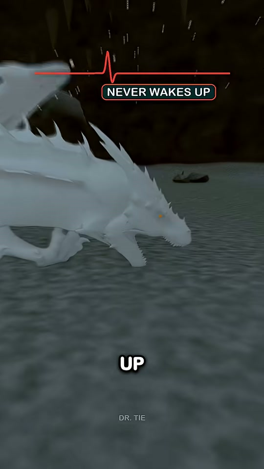 | 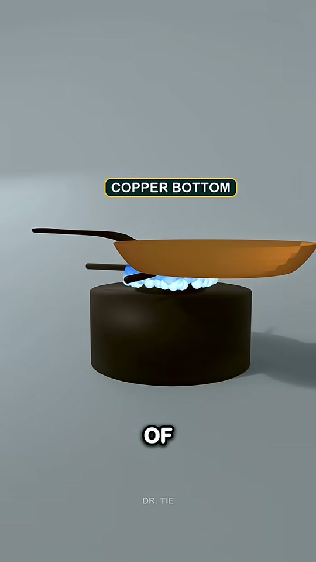 | 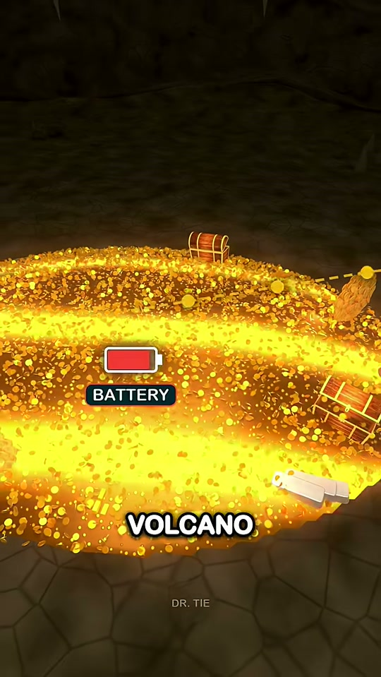 |
| Frost-textured 3D dragon on bare stone, `[BARE ROCK]` badge, and animated red heartbeat line snapping to `NEVER WAKES UP`. | Minimalist studio gray backdrop, black cylinder burner, blue flame spheres, and a copper pan (`[COPPER BOTTOM]`). | Glowing volcano heat radiating under gold coins with `[BATTERY]` icon and treasure chests. |

| 2D-on-3D Anatomical Cutaways | Simple Stylized Reference Animals | Physics Vectors & Torque Arrows |
|---|---|---|
| 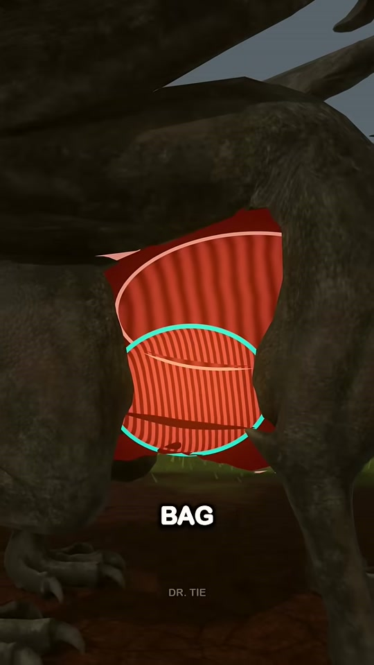 | 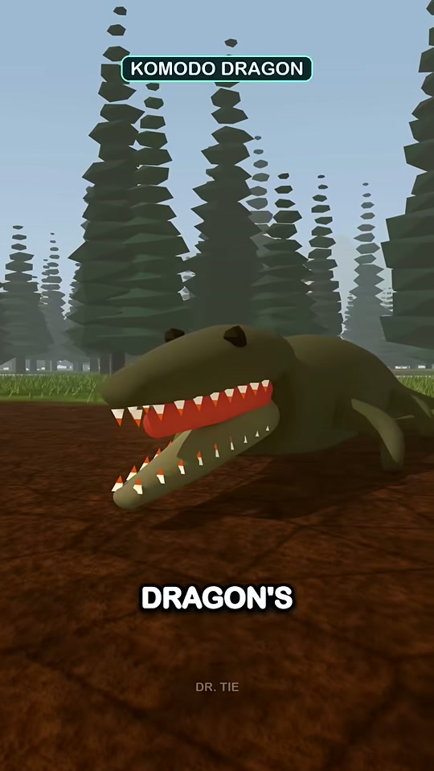 | 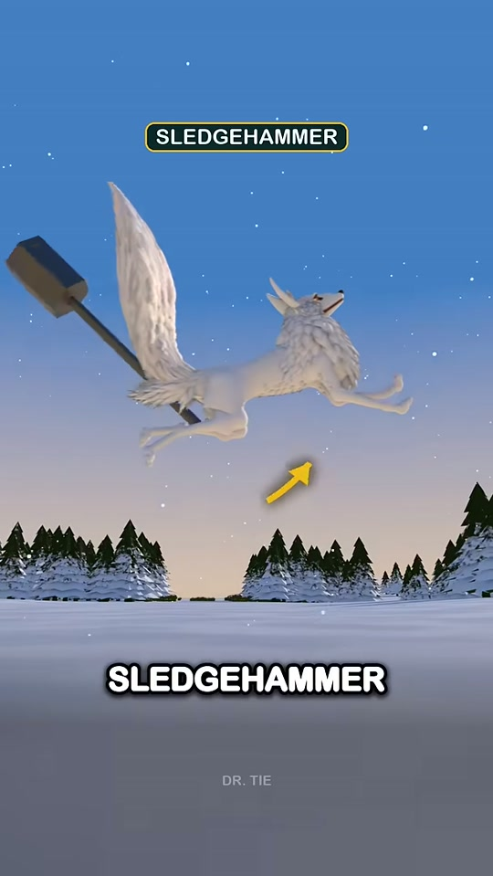 |
| Flat striped 2D organ cross-section embedded into the 3D dragon's torso with cyan highlight ring. | Low-poly capsule Komodo dragon with orange-tipped cone teeth (`[KOMODO DRAGON]`) in stacked-cone forest. | Literal 3D sledgehammer attached to fox hips + curved yellow torque arrow + `[SLEDGEHAMMER]` pill. |

| Real-World Scale Props | Engineering / Disaster Metaphors |
|---|---|
| 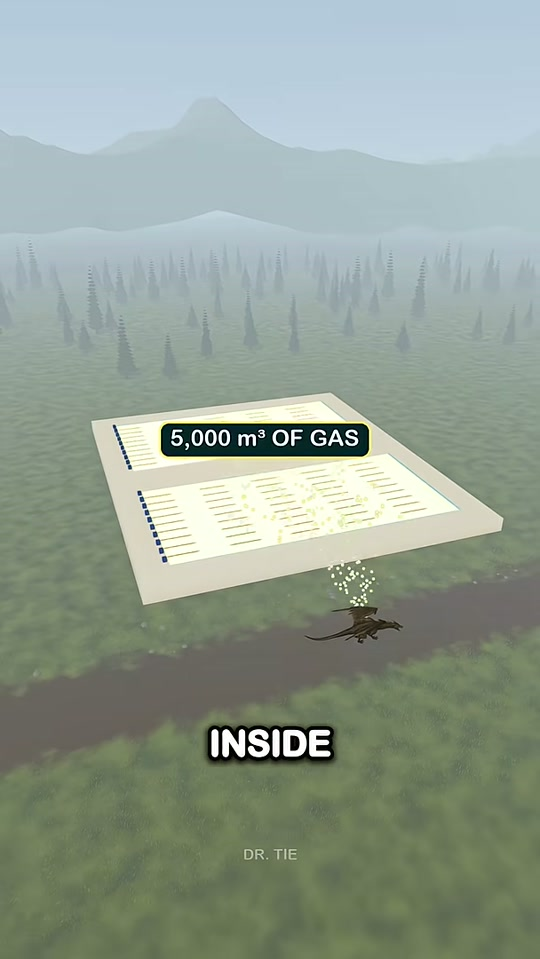 | 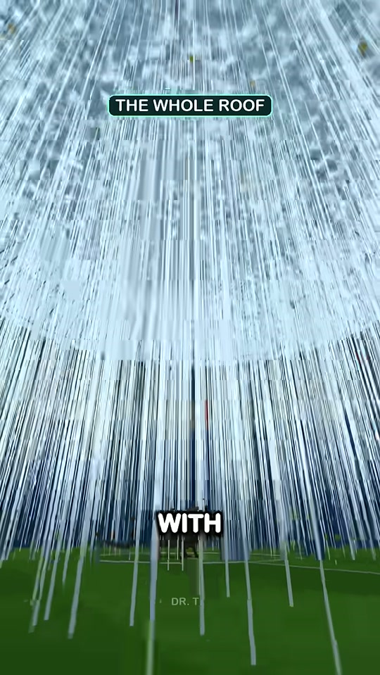 |
| Two floating 3D Olympic swimming pools next to the dragon (`[5,000 m³ OF GAS]`). | Dense particle streams flooding down from stadium dome (`[THE WHOLE ROOF]`). |

### Concrete Visual Rules Observed Across All 6 Videos

1. **Typography & Captions**:
   - **Single-word captions** centered at ~22–25% from the bottom (`BARE`, `ABOVE`, `VOLCANO`, `BAG`, `SWINGS`), in bold white sans-serif with heavy black drop-shadow/stroke.
   - Tiny muted watermark (`DR. TIE`) tucked safely below the subtitle line (~10% from bottom).
2. **Ground Strata Framing Trick**:
   - Outdoor scenes (`3kNwqcY18fg`, `1_GrgmdidsI`) place a **layered geological soil cutaway** across the bottom ~20% of the vertical frame. This elevates the floor plane (`y = 0`) cleanly above the Shorts UI & subtitle zone.
3. **Color-Coded Floating Pill Badges**:
   - Rounded dark pill containers (`#0E171D` fill, thin colored border):
     - **Cyan/Teal border**: Neutral subjects, animals, or engineering fixes (`[METAL IONS]`, `[KOMODO DRAGON]`, `[DOMED STADIUM]`, `[MOVIE WINGS]`).
     - **Gold/Amber border**: Materials, analogies, or measurements (`[COPPER BOTTOM]`, `[10 TONS]`, `[5,000 m³ OF GAS]`, `[TRUCKLOADS]`, `[SLEDGEHAMMER]`).
     - **Red border**: Failure states, limits, or lethal hazards (`[NEVER WAKES UP]`, `[NO ZOO ON EARTH]`, `[FIRE + HYDROGEN]`, `[CAN'T POUNCE]`).
4. **Diagrammatic Shortcuts (No Complex Rigging Required)**:
   - **2D-on-3D Cutaways**: Rather than modeling intricate 3D internal organs, flat vector-like stomach/throat cross-sections sit directly on the side of the animal mesh (`3kNwqcY18fg`) or bone cross-sections inside the arm (`1_GrgmdidsI`).
   - **Scale Primitives**: Glowing orange cube vs. four flat cyan tiles (`q7d8lm9fb8o`) to demonstrate $4\times$ surface area vs. $8\times$ volume; a balance beam comparing a 5-ton dragon to a 5-ton elephant (`O444KNBogMY`); a cyan boxy car balancing on a spring pogo stick (`1_GrgmdidsI`).
   - **Motion Blur Whip-Pans**: Fast horizontal whip-pans with heavy directional motion blur bridge major spatial or conceptual jumps (`q7d8lm9fb8o`, `O444KNBogMY`).

---

## 3. Complete Video-by-Video Breakdown, Visual Strips & Transcripts

---

### Video 1: `How a dragon would survive its own fire 🐉🔥 #shorts`
* **Link**: https://www.youtube.com/shorts/3kNwqcY18fg
* **Stats**: **5,893,727 views** | **242,262 likes** | **1,800 comments** | **70s** | Uploaded: 2026-11-06

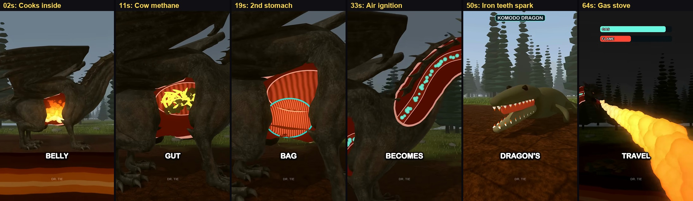

#### Visual Progression Notes
- **02s**: Dragon standing over layered earth cutaway; fiery glow inside belly cutaway.
- **11s**: Green plant matter inside gut cutaway (fermenting like a cow).
- **19s**: Zoomed-in second stomach highlighted with bright cyan ring.
- **33s**: Cross-section of curved dragon neck showing glowing cyan gas blobs moving upward toward mouth.
- **50s**: Low-poly Komodo dragon with red mouth & orange-tipped iron teeth (`[KOMODO DRAGON]`).
- **64s**: Dragon blasting flame rightward across frame while top HUD compares `GAS` (long cyan bar) vs. `FLAME` (short red bar).

#### Full Timestamped Transcript
```text
[00.00s] If a dragon keeps fire burning in its
[02.00s] belly, it cooks itself from the inside
[04.20s] in one second. So, you don't store fire,
[07.10s] you store fuel. You eat piles of rotting
[09.30s] plants and let the bacteria in your gut
[11.40s] turn them into methane, just like a cow.
[13.30s] But a cow's methane comes out in tiny
[15.30s] burps, barely enough to light a candle.
[17.20s] So, you grow a second stomach, [music] a
[19.00s] sealed bag of muscle and squeeze the gas
[21.40s] in under pressure. But now you've got a
[23.20s] belly full of explosive gas. One spark
[25.90s] and you blow up. Except methane can't
[28.00s] burn without oxygen. Pure gas sealed in
[30.50s] a bag is completely safe, just like a
[32.40s] fuel tank. It only becomes [music] fire
[34.20s] when it hits the air outside your mouth.
[36.20s] So now you need a spark. So you grow a
[38.70s] gland that drips a chemical that bursts
[40.90s] into flame the second [music] it touches
[42.50s] air. But it touches air the moment it
[44.30s] leaves the gland and your throat goes up
[46.10s] in flames. So you make your teeth out of
[48.30s] iron, just like a Komodo dragon's teeth
[50.20s] are coated in it, and you snap your jaws
[52.00s] shut like striking flint. Sparks fly
[54.30s] right [music] at the tip of your mouth.
[55.80s] But now the flame races backward down
[57.80s] the gas stream straight [music] into
[59.30s] your throat. So you squeeze that stomach
[61.50s] hard and blast the gas out faster than
[63.90s] the flame can travel back, like a gas
[65.70s] stove that only burns at the burner. The
[67.60s] fire stays in front of your face.
```

---

### Video 2: `Why Gold is the Ultimate Dragon Bedding?! 🐉🪙 #shorts` (Reference Video)
* **Link**: https://www.youtube.com/shorts/ReLBNFTi_9g
* **Stats**: **1,812,231 views** | **70,906 likes** | **316 comments** | **77s** | Uploaded: 2026-11-08

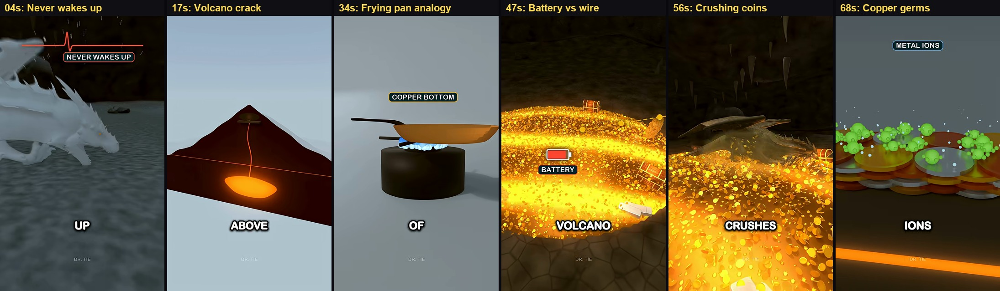

#### Visual Progression Notes
- **04s**: Frost-covered 3D dragon lying motionless on grey cave stone; red ECG line flatlines under `[NEVER WAKES UP]`.
- **17s**: Cutaway cross-section of a dark volcano peak showing glowing orange magma chamber below a tiny crack.
- **34s**: Clean studio shot of a copper-bottomed frying pan over blue gas burner flames (`[COPPER BOTTOM]`).
- **47s**: Mound of shiny coins glowing with hot magma veins beneath + `[BATTERY]` icon + dashed thermal line.
- **56s**: Dragon settles onto glowing coin pile, compressing it under its belly.
- **68s**: Macro close-up of stacked gold/silver/copper coin discs releasing glowing white particles that repel spiky green germ spheres (`[METAL IONS]`).

#### Full Timestamped Transcript
```text
[00.00s] If a dragon sleeps through the winter on
[01.84s] bare cave rock, it never wakes up. So,
[04.60s] you count on your size. A body [music]
[06.16s] as big as yours holds heat like a giant
[08.36s] thermos, but your belly is pressed
[09.96s] against cold [music] stone for 5 months,
[12.16s] and stone pulls heat out through touch
[14.04s] way faster than air ever could. So, you
[16.60s] find a cave right above a volcano, but
[18.56s] the heat only comes up through one
[20.12s] narrow crack in the floor, and the rest
[21.96s] of the rock stays freezing. You can't
[23.76s] curl a 10-ton body around a crack,
[25.55s] [music] so you need something that
[27.20s] spreads the heat out. Gold and silver
[29.24s] move heat about 100 times faster than
[31.40s] stone. So, you cover the floor in metal,
[33.56s] like the copper bottom of a frying pan
[35.32s] that spreads the flame across the whole
[37.00s] pan, and you think [music] you've built
[38.68s] a heat battery. But, gold is actually
[40.48s] terrible at holding heat. Kilo for kilo,
[43.00s] water holds 30 [music] times more. Gold
[45.16s] doesn't store heat, it moves it. The
[47.28s] volcano is the battery, the gold is the
[49.52s] wire. But, a loose pile of coins is full
[51.76s] of tiny air [music] gaps, and air is
[53.72s] insulation. So, you lie on top of it,
[55.96s] and your weight crushes the coins
[57.44s] together [music] until heat flows
[58.80s] straight into your belly. But, now
[60.26s] [snorts] you're sleeping for months in a
[61.72s] damp, dark cave, [music] and fungus
[63.64s] starts eating through your scales. So,
[65.64s] you mix in silver and copper. Their
[67.40s] metal ions kill germs on contact.
[69.43s] [music] That's why some hospitals use
[70.96s] copper door handles. And, now you know
[72.76s] why a dragon will burn down a kingdom
[74.88s] over one missing coin.
```

---

### Video 3: `Dragon Math: Why giant dragons are impossible 🐉🚫 #shorts`
* **Link**: https://www.youtube.com/shorts/q7d8lm9fb8o
* **Stats**: **1,276,966 views** | **41,733 likes** | **535 comments** | **72s** | Uploaded: 2026-11-07

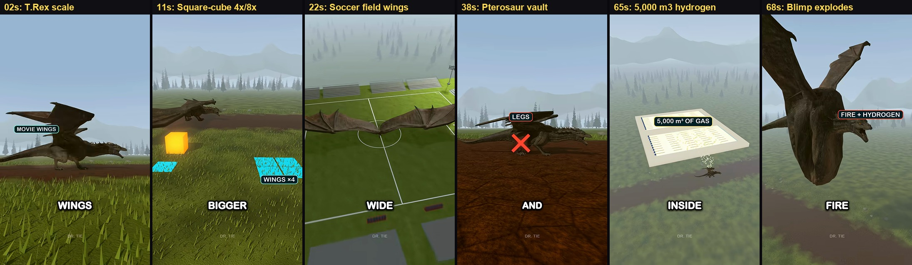

#### Visual Progression Notes
- **02s**: Dragon standing on dirt path in misty pine valley (`[MOVIE WINGS]` badge pointing to small wings).
- **11s**: Square-cube math visualized directly on grass: 4 flat cyan squares (`[WINGS ×4]`) vs. glowing orange cube ($2\times2\times2 = 8\times$ volume).
- **22s**: Overhead shot of giant dragon wings stretching wall-to-wall across a 3D soccer pitch (`[10 TONS]`).
- **38s**: Red `X` stamped over dragon's hind legs (`[LEGS]`).
- **65s**: Two floating Olympic swimming pools hovering above dragon (`[5,000 m³ OF GAS]`) with rising bubbles.
- **68s**: Bloated blimp-like dragon floating in sky (`[FIRE + HYDROGEN]`) right before fireball explosion.

#### Full Timestamped Transcript
```text
[00.00s] If you give a dragon the size of a
[01.60s] T.Rex, the wings you see in movies can't
[03.90s] even lift its tail off the ground. So,
[06.20s] you make the wings bigger, but size is
[07.90s] working against you. Double your size
[10.00s] and your wings get four times bigger,
[11.80s] but your body gets eight times heavier.
[13.80s] Every time you grow, weight wins. So,
[16.40s] you keep stretching your wings until
[18.00s] they can finally hold you. For a 10-ton
[20.40s] dragon, that's wings about as wide as a
[22.40s] soccer field, but now you have to flap
[24.60s] them, and muscle strength grows slower
[26.50s] than body weight. The biggest animals
[28.10s] that ever flapped their way into the sky
[30.00s] topped out around the weight of a lion.
[31.80s] So, you shrink down and copy the
[33.60s] pterosaurs. You hollow out your bones
[35.60s] and fill them [music] with air. You stop
[37.10s] jumping with your legs and vault off
[38.80s] your arms like a pole vaulter, and it
[40.60s] works. You fly, but you're not a dragon
[42.90s] anymore. You're a giant stork. So, you
[45.20s] go back to 10 tons and fill your body
[47.10s] with gas instead. Birds already have air
[49.40s] sacs inside them, but air inside air
[51.80s] weighs exactly the same. It doesn't lift
[53.80s] you at all. So, you fill the sacs with
[55.80s] hydrogen. Your gut bacteria already make
[57.90s] it, but every cubic meter only lifts
[59.80s] about 1 kg. Just to carry half your
[62.10s] weight, you'd need two Olympic swimming
[64.00s] pools of gas inside you. So, now you're
[66.10s] the size of a blimp, and you breathe
[68.10s] fire. So, the first time it opens its
[70.10s] mouth, it explodes.
```

---

### Video 4: `How Did Giant Pterosaurs Launch Into the Air? 🦖🪽 #shorts`
* **Link**: https://www.youtube.com/shorts/1_GrgmdidsI
* **Stats**: **1,142,231 views** | **41,688 likes** | **215 comments** | **70s** | Uploaded: 2026-11-05 (Channel's 1st Upload)

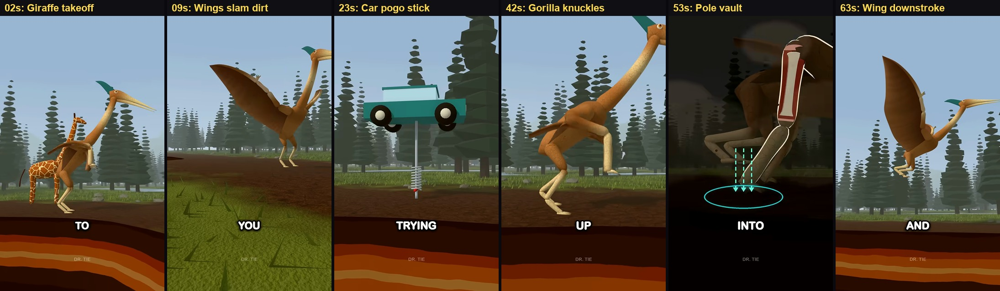

#### Visual Progression Notes
- **02s**: Quetzalcoatlus standing side-by-side with a 3D giraffe for instant scale clarity; bottom shows layered earth cutaway.
- **09s**: Flapping wings slam onto dirt ground.
- **23s**: Low-poly teal sedan bouncing on a spring pogo stick.
- **42s**: Pterosaur walking on folded wing knuckles alongside a dark gorilla silhouette.
- **53s**: Darkened X-ray frame showing internal hollow arm bones + 3 dashed cyan downward force vectors onto a glowing cyan ring.
- **63s**: Mid-air vault launch with wings snapping open on first downstroke.

#### Full Timestamped Transcript
```text
[00.00s] If an animal the size of a giraffe tries
[02.08s] to take off like a bird, it never leaves
[04.12s] the ground. So, you run like a bird.
[06.12s] But, your wings stretch 10 m across, and
[08.60s] every time you flap, they slam into the
[10.56s] dirt. And to lift your body into the air,
[12.08s] you need a runway longer than a
[13.88s] soccer field. [music] So, you jump like
[15.84s] a bird. Birds don't really fly off the
[17.72s] ground. Their legs throw them into the
[19.60s] air first. But, your legs are tiny
[21.48s] compared to your body. Jumping with them
[23.12s] is like trying to launch a car with a
[24.68s] pogo stick. So, you make your legs huge
[27.28s] and muscular. But, now you're way too
[29.00s] heavy to fly. And your bones [music] are
[30.64s] hollow tubes with walls so thin that
[32.96s] heavy legs would just snap them. So, you
[35.04s] stop looking at your legs and look at
[36.72s] your arms. Your flight muscles are
[38.40s] already the strongest muscles in your
[40.04s] body. So, you fold your wings up and
[42.28s] walk on your knuckles like a gorilla.
[43.96s] But, if you just push off with your
[45.32s] arms, you tip forward and face plant.
[47.60s] So, you crouch, kick your back legs
[49.60s] first to throw your body forward over
[51.60s] your arms, and then slam your knuckles
[53.40s] into the ground like a pole vaulter
[54.96s] planting the pole. And you fling
[56.44s] yourself 2 [music] m into the air. But,
[58.32s] now you're falling with your wings
[59.68s] folded. So, the instant your hands leave
[61.72s] the ground, you snap your wings open and
[63.68s] hit the first downstroke before you
[65.40s] drop. Congratulations, you just launched
[67.40s] one of the biggest animals that ever
[69.12s] flew.
```

---

### Video 5: `How Nine Tails Would Actually Ruin a Kitsune's Life 🦊❄️ #shorts`
* **Link**: https://www.youtube.com/shorts/fhR0BCsPl1M
* **Stats**: **151,608 views** | **5,140 likes** | **78 comments** | **71s** | Uploaded: 2026-11-09

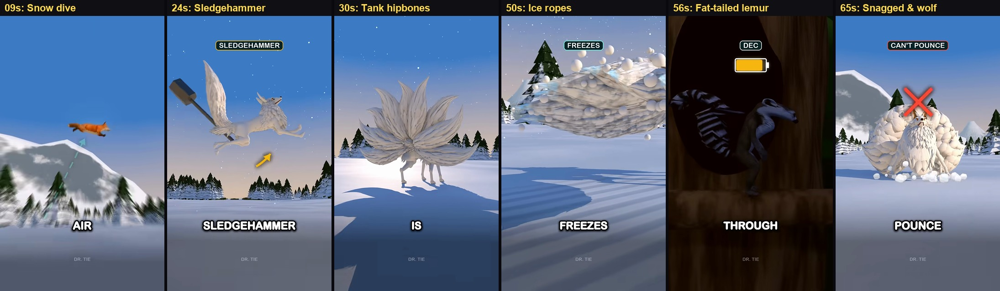

#### Visual Progression Notes
- **09s**: Red fox leaping along dashed cyan trajectory curve above snowy mountain backdrop.
- **24s**: White kitsune mid-leap with a literal 3D sledgehammer attached to its tail base + yellow curved torque arrow + `[SLEDGEHAMMER]` pill.
- **30s**: Rear silhouette showing massive bulky nine-tail fan dragging behind skinny hind legs.
- **50s**: Close-up of dragging fur tails clumped with snowballs & frost (`[FREEZES]`).
- **56s**: Stylized fat-tailed lemur inside dark hollow tree log with draining orange battery meter labeled `[DEC]`.
- **65s**: Round, overgrown kitsune stuck in snow with red `X` and `[CAN'T POUNCE]` alert.

#### Full Timestamped Transcript
```text
[00.08s] In legends, a fox with nine tails
[01.96s] [music] is the wisest creature in the
[03.92s] forest. In real life, it couldn't catch
[05.92s] a single mouse. A fox hunts by leaping
[08.32s] high into the air and diving nose first
[10.48s] into the snow, using its tail like a
[12.40s] rudder to steer. [music] So, you give
[14.08s] your fox nine real tails, each one full
[16.64s] of bones and muscle, just like a normal
[18.48s] tail. But now, there's a bundle of
[20.16s] weight hanging off the back of your
[21.52s] hips. Every time you leap, it swings
[23.44s] like a sledgehammer and flips you onto
[25.28s] your back. So, you grow massive hipbones
[27.51s] [music] and thick ligaments to hold them
[29.20s] steady. But now your back end is built
[30.96s] like a tank. You can't leap at all. And
[32.80s] the mouse hears you [music] coming from
[34.00s] across the field. So you take the bones
[36.16s] out, just fur. Nine tails as light as
[38.40s] feather dusters. And at least [music]
[40.00s] you're warm. A fox sleeps wrapped in its
[42.08s] tail like a blanket. And you've got nine
[43.76s] of them. But a tail with no bones can't
[45.92s] move. You can't steer with it. It just
[47.84s] drags behind you, soaks up the snow, and
[50.08s] freezes [music] into nine heavy ropes of
[52.00s] ice. So you fill them with fat instead.
[54.32s] Like the fat-tailed lemur that sleeps
[56.08s] through the winter living off its tail.
[57.76s] Now you never [music] starve. But fat is
[59.84s] heavy, too. You're right back to hauling
[61.60s] a sack behind your hips. Except now
[63.52s] you're round. It's fat. [music] It can't
[65.44s] pounce. And its tails snag on every bush
[67.76s] in the forest. The first wolf that finds
[69.68s] it gets an easy
```

---

### Video 6: `Could a Dragon Actually Live in a Zoo? 🐉🔥 #shorts`
* **Link**: https://www.youtube.com/shorts/O444KNBogMY
* **Stats**: **28,336 views** | **1,320 likes** | **26 comments** | **76s** | Uploaded: 2026-11-09

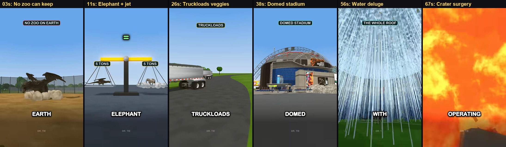

#### Visual Progression Notes
- **03s**: Dragon landing in sandy fenced zoo enclosure with dust clouds (`[NO ZOO ON EARTH]`).
- **11s**: Simple golden balance scale with `=` sign comparing `[5 TONS]` dragon vs. `[5 TONS]` elephant.
- **26s**: Convoy of silver semi-trucks driving down curving asphalt road (`[TRUCKLOADS]`).
- **38s**: 3D domed stadium model (`[DOMED STADIUM]`).
- **56s**: Massive deluge of vertical water lines flooding down from the roof (`[THE WHOLE ROOF]`).
- **67s**: Full-screen fiery fireball explosion filling the frame.

#### Full Timestamped Transcript
```text
[00.00s] If fire dragons were alive today, no zoo
[02.72s] on Earth could keep one. Not San Diego,
[05.20s] not Singapore. And it's not because of
[06.88s] the food. Here's why. Let's say your
[08.56s] dragon weighs about 5 tons, roughly an
[10.88s] elephant, with wings wider than a
[12.56s] passenger jets. [music] It's
[13.68s] warm-blooded and flying burns energy
[15.68s] like crazy. So, you're feeding it a
[17.36s] sheep or two every single day. But
[19.20s] that's just to keep it alive. Its fire
[21.12s] runs on methane made by fermenting
[23.04s] plants in its gut like a cow. So, on top
[25.04s] of the meat, you're [music] hauling in
[26.16s] truckloads of vegetables just to keep
[28.08s] the fire lit. And here's the weird part.
[30.00s] The food is the cheapest thing about it.
[32.08s] To take off with wings that wide, it
[34.08s] needs a space hundreds of meters across.
[36.24s] So, you're not building an enclosure.
[37.76s] You're building a do stadium. And
[39.60s] stadiums with roofs cost well over a
[41.84s] billion dollars. But a methane flame
[43.76s] burns at almost 2,000°. And steel starts
[46.80s] losing its strength at around 500. Every
[49.12s] time your dragon gets annoyed, it's
[50.80s] melting your ceiling. So, you copy
[52.80s] rocket launch pads and install a [music]
[54.48s] system that floods the whole roof with
[56.32s] water every time it breathes fire. And
[58.32s] if it gets sick, vets do put elephants
[60.40s] to sleep. But elephants don't have a
[62.00s] belly full of explosive gas, and
[64.00s] surgeons cut with electric tools that
[65.84s] spark. One wrong move and your operating
[67.92s] room becomes a crater. So, could we
[70.00s] actually keep a fire dragon in a zoo?
[72.00s] Technically, yes. [music] But your
[73.44s] insurance company would cancel you
[74.88s] before it even landed.
```

---

## 4. Script Architecture: Why Retention Is So High

Every single script follows a strict **70–77 second**, **~180–210 word** blueprint built on five mechanisms:

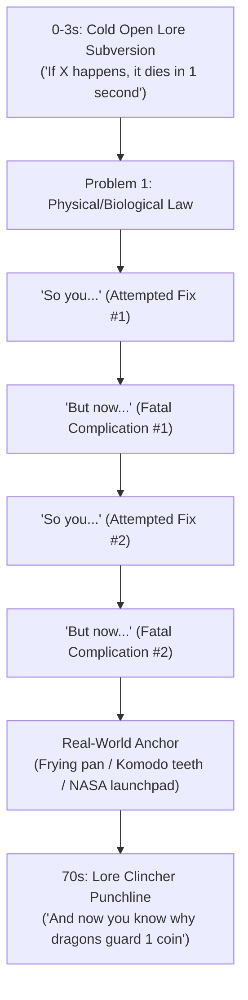

### 1. Zero-Fluff Cold Open (0–3s)
* Never shows a logo, title card, or *"Today we're talking about..."*.
* Immediately breaks an iconic fantasy assumption with lethal stakes:
  * *"If a dragon keeps fire burning in its belly, it cooks itself from the inside in one second."*
  * *"If a dragon sleeps through the winter on bare cave rock, it never wakes up."*
  * *"In legends, a fox with nine tails is the wisest creature in the forest. In real life, it couldn't catch a single mouse."*

### 2. Second-Person Engineering Agency ("So, you..." / "But, now...")
* Uses the exact second-person loop that SimForge's trap scripts already use—except instead of placing dungeon traps, **you** are solving real biological/physics constraints inside the creature:
  * *"So, you grow a second stomach... **But now** you've got explosive gas... **So** you seal it without oxygen... **So** now you need a spark... **But** it touches air in your throat... **So** you make your teeth out of iron..."*
* Notice how **every solution immediately creates the next disaster**. Viewers cannot swipe away because each "So..." resolves one question and immediately opens a harder one.

### 3. Real-World Scientific Anchors
Never hand-waves anything as "magic." Every step anchors to something tangible the viewer recognizes:
* Copper frying pans & thermal conductivity
* Water holding 30× more heat than gold
* Hospital copper door handles (oligodynamic effect)
* Cow gut methane fermentation
* Komodo dragon iron-coated teeth
* Gas stove burner flame velocity
* NASA rocket launch pad water deluge systems

### 4. The Lore Reframing Clincher (Last 4 Seconds)
Ends on an unforgettable punchline that makes classic fantasy tropes suddenly make complete scientific sense:
* *"And, now you know why a dragon will burn down a kingdom over one missing coin."*
* *"The fire stays in front of your face."*
* *"Your insurance company would cancel you before it even landed."*

### 5. Topic Selection Signal (Notice What Flopped vs. Exploded)
Look at the view counts:
* **Dragons & Giant Dinosaurs**: **1.1M – 5.9M views** (massive, universal curiosity; notice how *How a dragon would survive its own fire* hit 5.89M and *Gold Bedding* hit 1.81M).
* **Kitsune (151K)** and **Dragon in a Zoo (28K)**: Notice `Zoo` was uploaded the same day as `Kitsune` (Nov 9), AND notice `Zoo` shifted away from **"how the creature's biology actually works"** into **"hypothetical modern logistics"** (*"not because of food... cost a billion dollars... insurance company"*). The pure **creature biomechanics + famous myth payoff** videos (`Survive Fire`, `Gold Bedding`, `Dragon Math`) performed **10×–200× stronger**.

---

## 5. Why SimForge Should Pivot & How to Execute It

### Why Current SimForge Struggles on Retention
1. **No Curiosity Gap in the First 3 Seconds**: *"Level 1: Spike Pit"* reads like a mobile game ad or generic ragdoll test. Viewers already know spikes hurt goblins.
2. **No Knowledge Payoff**: Watching a rogue jump over a trap and a paladin block a boulder delivers mild slapstick, but zero *"Wait, really?! That's actually true?!"* shareability.
3. **High Production Overhead**: Each episode currently builds 5 separate trap machines, 4 hero classes, complex floor cutouts, and stage HUDs.

### Why SimForge's Tech Stack Fits This Format Out of the Box
* **Remotion + React Three Fiber (1080×1920 @ 30fps)**: Already built.
* **Gemini TTS + Word-Level Cues (`narrationCues.json` / `wordTimestamps.json`)**: Already built—perfect for Dr. Tie's single-word kinetic captions and exact beat-synced cutaways.
* **Procedural Materials (`vinyl`, `glow`, `useSurface`) & `Burst` VFX**: Ideal for glowing thermal gradients, glowing methane bubbles, sparks, and layered strata floors.
* **Even Simpler Asset Pipeline**: Instead of 5 complex mechanical traps per short, one episode uses:
  - 1 main creature/subject (or low-poly silhouette + 2D cutaway plane);
  - 3–4 minimalist scale/analogy props (frying pan, balance scale, swimming pool, cube vs. tiles);
  - Simple HUD pill labels + dashed arrows + bar charts.

---

## 6. Pilot Episode Concepts Ready for SimForge

| Working Title | 0-3s Cold Open Hook | Escalation Chain (The "So You / But Now" Loop) | Real Science Anchor | Clincher Payoff |
|---|---|---|---|---|
| **Why Dragon Scales Deflect Ballistas (Non-Newtonian Armor)** | *"If a dragon's scales were solid steel, it would be too heavy to fly. If they were normal reptile scales, a wooden arrow would pierce its heart."* | Keratin scales $\rightarrow$ too soft $\rightarrow$ steel plates $\rightarrow$ grounded $\rightarrow$ liquid shear-thickening gel under scales $\rightarrow$ flexes softly in flight, turns rock-hard on ballista impact $\rightarrow$ shockwave bruises ribs $\rightarrow$ honeycomb shock-absorbing bone. | Oobleck / D3O armor & avian honeycomb bones | *"That's why a knight's arrow bounces right off—but a heavy warhammer still wins."* |
| **How a Gelatinous Cube Doesn't Melt Its Own Floor** | *"A Gelatinous Cube dissolves steel armor and bones in seconds. So why doesn't it melt the stone floor and sink straight to the Earth's core?"* | Hydrochloric acid melts flesh $\rightarrow$ acid also eats limestone floors $\rightarrow$ alkaline slime layer $\rightarrow$ neutralizes acid $\rightarrow$ targeted enzymes (protease & collagenase) only break down organic tissue + rust bacteria for iron $\rightarrow$ leaves granite spotless. | Digestive enzymes & bio-leaching bacteria | *"You don't have a dungeon monster. You have an eight-ton biological Roomba."* |
| **Why Trolls Turn to Stone in Sunlight** | *"If sunlight turns a troll into solid rock in five seconds, its veins aren't pumping blood—they're pumping liquid 3D-printer resin."* | Extreme regeneration needs instant cell scaffolding $\rightarrow$ liquid monomer blood $\rightarrow$ UV-sensitive photoinitiator molecules $\rightarrow$ 380nm sunlight triggers runaway photopolymerization $\rightarrow$ whole body crosslinks into rigid calcium-silicate stone. | SLA UV-cured dental/3D-printer resin | *"Trolls don't hate the sun because of a curse. They're allergic to ultraviolet curing."* |
| **The Physics of a Medusa / Basilisk Gaze** | *"Looking at a Basilisk turns you to stone. Looking at its reflection in a shield only stuns you. Only one real phenomenon works like that."* | Venom spit vs. light beam $\rightarrow$ bioluminescent UV/X-ray eye flash $\rightarrow$ intense enough to coagulate proteins/calcium $\rightarrow$ polished bronze mirror absorbs/scatters short wavelengths $\rightarrow$ inverse-square dropoff + diffused reflection saves Perseus. | UV-C / bronze reflectivity curve | *"Perseus didn't beat a monster with magic. He used a low-pass optical filter."* |
| **How a Phoenix Actually Rebirths From Ashes** | *"If a bird bursts into 1,000-degree flames, it doesn't leave a baby chick behind. It leaves a pile of carbon."* | Aging birds accumulate parasites & damaged proteins $\rightarrow$ dormant stem-cell egg buried deep in mineral ash-shell (like bacterial endospores) $\rightarrow$ pyrophoric fat secretion ignites nest $\rightarrow$ heat sterilizes parasites & turns dead parent into phosphorus/potassium fertilizer $\rightarrow$ heat shock wakes the embryo. | *Bacillus* endospores & serotinous pine cones | *"It's not resurrection. It's the most aggressive heat-sterilization in nature."* |
